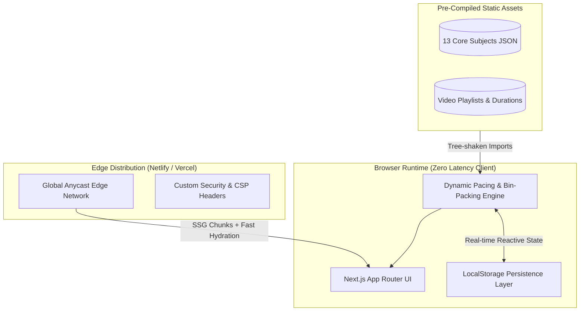

<div align="center">

# 🚀 G28 — Intelligent GATE CSE Preparation Architecture

### *A High-Performance, Privacy-First Study Roadmap & Dynamic Pacing Engine for GATE CSE 2028 Aspirants*

[](https://nextjs.org/)
[](https://react.dev/)
[](https://www.typescriptlang.org/)
[](https://tailwindcss.com/)
[](LICENSE)

[Live Demo](https://gate-2028-tracker.netlify.app) • [Report Issue](https://github.com/JaysukhCSE28/g28/issues) • [Author Profile](https://github.com/JaysukhCSE28)

</div>

---

## 📌 Executive Summary

**G28** is an interactive, browser-native learning roadmap and algorithmic syllabus tracking system tailored for the **Graduate Aptitude Test in Engineering (GATE) - Computer Science & Information Technology 2028**. 

Built with **Next.js 15 App Router** and **TypeScript**, G28 addresses a critical problem for long-horizon aspirants: *cognitive overload and poor pacing when tackling a 1,000+ hour syllabus spanning 13 core disciplines*. 

Instead of traditional, heavyweight LMS platforms burdened by mandatory account creation and remote database latency, G28 leverages an **Edge-cached static architecture** paired with a **client-side dynamic bin-packing algorithm** to compute adaptive, day-by-day study schedules in real time—with zero latency and 100% data privacy.

---

## 🏗️ Architecture & Core System Design



### 1. Dynamic Bin-Packing Study Scheduler
At the core of each subject view is a client-side scheduling engine. Given:
- Daily study capacity $T_{\text{daily}}$ (hours and minutes configured by user)
- Playback velocity factor $V \in [1.0, 1.25, 1.5, 1.75, 2.0]$
- Array of video durations $D = [d_1, d_2, \dots, d_n]$ where adjusted duration $d_i' = \frac{d_i}{V}$

The engine greedily groups curriculum units into discrete **study days**:
$$\sum_{i \in \text{Day}_k} d_i' \le T_{\text{daily}}$$

This recalculates instantly as the student adjusts target velocity or daily commitment, providing immediate visual feedback on their exact completion date.

### 2. Privacy-First Local State Management
- **No telemetry leakage**: All progress checkmarks, speed preferences, and pagination states persist in browser `localStorage`.
- **Fault-tolerant parsing**: Schema-validated state initialization with defensive fallbacks against corrupted cache structures.

---

## ⚡ Technical Highlights & Engineering Decisions

| Feature | Architectural Decision | Benefit |
|---|---|---|
| **Rendering Strategy** | Static Site Generation (SSG) with client hydration | Near-instant First Contentful Paint (FCP) and optimal Lighthouse SEO scores |
| **Styling & Design System** | Tailwind CSS + Radix UI Primitives (`shadcn/ui`) | Accessible (ARIA-compliant), headless UI with minimal CSS bundle footprint |
| **Type Safety** | Strict TypeScript (`noImplicitAny: true`, strict null checks) | End-to-end type safety eliminating runtime null-dereference errors |
| **Security Posture** | Custom Content Security Policy (CSP), Frame Options (`DENY`), HSTS | Immunity to XSS injections, clickjacking, and unauthorized third-party telemetry |
| **Zero Backend Overhead** | Decoupled client-side architecture | Infinite horizontal scalability at **$0 server infrastructure cost** |

---

## 📚 Curriculum Coverage (13 Core GATE CSE Subjects)

G28 organizes and indexes hundreds of hours of high-yield lectures across the comprehensive GATE CSE syllabus:

* 🧮 **Discrete Mathematics** (Set Theory, Graph Theory, Combinatorics, Mathematical Logic)
* ⚙️ **Theory of Computation** (Automata Theory, Regular Grammars, Decidability, Turing Machines)
* 🌐 **Computer Networks** (OSI/TCP-IP, Routing Algorithms, Flow/Congestion Control, Application Layer)
* 🗄️ **Database Management Systems** (Relational Algebra, SQL, Normalization, ACID Transactions, Indexing)
* 💻 **C Programming** (Pointers, Memory Layout, Recursion, Structure & Unions)
* ⚡ **Digital Logic** (Boolean Algebra, Combinational & Sequential Circuits, Minimization)
* 🖥️ **Operating Systems** (Process Synchronization, Concurrency, Deadlocks, Virtual Memory)
* 🏛️ **Computer Organization & Architecture** (Pipelining, Cache Memory, Instruction Formats)
* 📦 **Data Structures** (Linear & Non-linear Structures, Trees, Heaps, Hashing)
* 🎯 **General Aptitude** (Numerical Ability, Logical Reasoning, Spatial Comprehension)
* 📐 **Engineering Mathematics** (Linear Algebra, Calculus, Probability & Statistics)
* 🔧 **Compiler Design** (Lexical Analysis, Top-Down/Bottom-Up Parsing, Intermediate Code Generation)
* ⚡ **Algorithms** (Asymptotic Analysis, Divide & Conquer, Dynamic Programming, Greedy Methods)

---

## 🛠️ Local Development & Setup

### Prerequisites
- **Node.js** `>= 18.17.0`
- **npm** or **pnpm**

### Installation

```bash
# 1. Clone repository
git clone https://github.com/JaysukhCSE28/g28.git
cd g28

# 2. Install dependencies
npm install

# 3. Launch development server
npm run dev
```

Visit [`http://localhost:3000`](http://localhost:3000) to inspect the live local build.

### Production Build & Verification

```bash
# Compile and validate static type integrity
npm run build

# Start production server locally
npm run start
```

---

## 🔒 Security Hardening

The application enforces an enterprise-grade Content Security Policy (CSP) headers configuration:

```javascript
// next.config.js snippet
const securityHeaders = [
  { key: "Content-Security-Policy", value: "default-src 'self'; script-src 'self' 'unsafe-eval' 'unsafe-inline'; child-src *.youtube.com; img-src * blob: data:;" },
  { key: "X-Frame-Options", value: "DENY" },
  { key: "X-Content-Type-Options", value: "nosniff" },
  { key: "Strict-Transport-Security", value: "max-age=31536000; includeSubDomains; preload" },
  { key: "Permissions-Policy", value: "camera=(), microphone=(), geolocation=()" }
];
```

---

## 🗺️ Engineering Roadmap (Phase 2 & Beyond)

- [ ] **Cross-Device Cloud Sync**: Optional OAuth2 (Google) integration with Supabase / PostgreSQL.
- [ ] **PYQ Practice Engine**: Tagged GATE past-year question bank with immediate feedback & timer.
- [ ] **Spaced Repetition Scheduler**: Automated Leitner review alerts based on forgetting curves.
- [ ] **Offline PWA Support**: Full ServiceWorker precaching for offline syllabus revision on mobile.

---

## 👤 Author & Maintainer

**Jaysukh Sesham**
- **GitHub:** [@JaysukhCSE28](https://github.com/JaysukhCSE28)
- **Role:** Lead Project Architect & Developer

---
